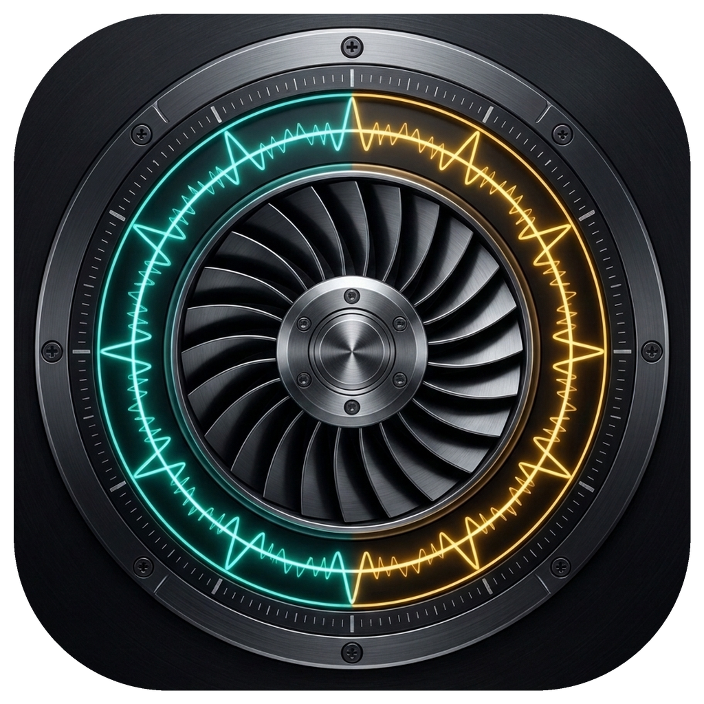
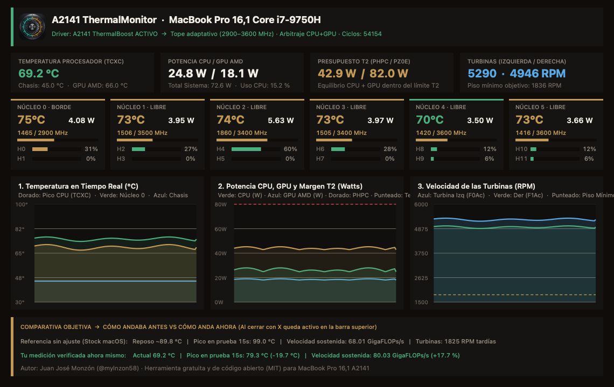

<p align="left">
  
</p>

# A2141 ThermalMonitor — Monitor de Núcleos, Potencia (W) y Turbinas para MacBook Pro 16" 2019 (A2141)

**Autor:** Juan Monzón · `@mylnzon58`  
**Web del monitor:** https://mylnzon58.github.io/a2141-macos-thermal-monitor/  
**Driver complementario (A2141 ThermalBoost):** https://github.com/mylnzon58/t2-macbook-pro-16-1-thermal-performance-fix-macos  
**Licencia:** MIT  



---

## Para qué sirve esta aplicación

**A2141 ThermalMonitor** es una aplicación nativa y liviana para macOS pensada para que cualquier usuario de la **MacBook Pro de 16 pulgadas de finales de 2019, modelo A2141 con procesador Core i7-9750H**, pueda ver de forma clara e intuitiva qué está pasando dentro de su equipo en tiempo real y corroborar con gráficas cómo funcionaba antes y cómo funciona después de aplicar nuestro driver **A2141 ThermalBoost**.

No requiere permisos de administrador para abrirse ni consume recursos pesados: está escrita directamente en código nativo de macOS, pesa menos de 100 KB y se instala tanto en tu carpeta de **Aplicaciones** como en la **barra superior de macOS**.

---

## Qué muestra en pantalla en tiempo real

```
1. Barra superior de macOS       →  Temperatura actual, consumo en Watts y RPM de turbinas siempre visibles.
2. Estado del equipo             →  Indica al instante si el equipo está en modo original de fábrica o con el ajuste por núcleo activo.
3. Mapa de los 6 núcleos físicos →  Temperatura individual, tope de frecuencia en MHz y barras de carga de los 12 hilos en vivo.
4. Tres gráficas en tiempo real  →  1) Curva de temperaturas de CPU, Núcleo 0 y chasis.
                                    2) Consumo en Watts frente al techo disponible en el chip T2.
                                    3) Velocidad de las dos turbinas en RPM frente al piso mínimo.
5. Comparador Antes vs. Después  →  Botón integrado "Medir 15s" para correr una prueba y comparar tus números contra el estado original, más botón para guardar captura en PNG.
```

---

## En qué equipo funciona

```
Modelo           →  MacBook Pro de 16 pulgadas de finales de 2019
Identificador    →  MacBookPro16,1 · Chasis A2141
Procesador       →  Intel Core i7-9750H de 6 núcleos y 12 hilos
Sistema          →  macOS Catalina 10.15 hasta macOS Sequoia 15 o superior
Requisito        →  Herramientas de compilación de Xcode (xcode-select --install)
```

---

## Descarga directa e instalación (Sin compilar)

Ya incluimos la aplicación compilada con su ícono nativo de macOS en varios formatos listos para abrir:

- **Imagen de disco (`.dmg` — Arrastrar a Aplicaciones):**  
  **[Descargar A2141-ThermalMonitor-v1.1.0-macOS.dmg](https://github.com/mylnzon58/a2141-macos-thermal-monitor/releases/download/v1.0.0/A2141-ThermalMonitor-v1.1.0-macOS.dmg)**
- **Instalador automático de macOS (`.pkg` — Doble clic):**  
  **[Descargar A2141-ThermalMonitor-v1.1.0-Installer.pkg](https://github.com/mylnzon58/a2141-macos-thermal-monitor/releases/download/v1.0.0/A2141-ThermalMonitor-v1.1.0-Installer.pkg)**
- **Archivo comprimido directo (`.zip`):**  
  **[Descargar A2141-ThermalMonitor-v1.1.0-macOS.zip](https://github.com/mylnzon58/a2141-macos-thermal-monitor/releases/download/v1.0.0/A2141-ThermalMonitor-v1.1.0-macOS.zip)**

> **Si macOS muestra *"Apple no pudo verificar que A2141Monitor no contenga software malicioso"*:**  
> Al ser software libre sin firma comercial paga de Apple, macOS bloquea la primera apertura de archivos descargados desde el navegador. Haz clic en **Listo**, abre **Ajustes del Sistema → Privacidad y Seguridad → Seguridad** y presiona **"Abrir de todas formas"** (o ejecuta `xattr -cr /Applications/A2141Monitor.app`).

### Opción por Terminal (usando el binario precompilado incluido en `prebuilt/`)

```bash
git clone https://github.com/mylnzon58/a2141-macos-thermal-monitor.git
cd a2141-macos-thermal-monitor
chmod +x install.sh uninstall.sh
./install.sh
```
*(Si prefieres compilar desde el código fuente en lugar de usar el binario precompilado, puedes ejecutar `./install.sh --compile`).*

*Nota: No requiere desactivar SIP ni entrar en Modo Recuperación para usar el monitor. Si además quieres instalar el driver que reduce las temperaturas y equilibra los núcleos, puedes seguir la guía en el repositorio principal:*  
→ **[Driver y ajuste térmico para MacBook Pro 16,1 A2141](https://github.com/mylnzon58/t2-macbook-pro-16-1-thermal-performance-fix-macos)**

---

## Cómo usarla para comparar Antes y Después

1. **Antes de aplicar el ajuste térmico:** Abre `A2141 Monitor`, observa la temperatura en reposo y presiona el botón **"Medir 15s (Comparar)"** arriba a la derecha. Guarda tu primera captura con el botón **"Guardar Captura PNG"**.
2. **Después de instalar el driver térmico:** Vuelve a abrir `A2141 Monitor`. Verás en el encabezado verde que el **Núcleo 0 queda limitado a 3200 MHz** mientras los demás núcleos llegan hasta 4500 MHz, y podrás volver a tocar **"Medir 15s (Comparar)"** para corroborar cuántos grados bajó tu equipo y cuántos GigaFLOPs por segundo sostiene.

---

## Cómo desinstalar

Si deseas quitar la aplicación en cualquier momento:

```bash
./uninstall.sh
```

---

## Apoyo al proyecto y contacto

Comparto esta herramienta de manera libre y con humildad, esperando que ayude a entender y medir de forma visual el comportamiento térmico de esta MacBook. Si te resulta útil en tu día a día:

- **GitHub Sponsors:** [github.com/sponsors/mylnzon58](https://github.com/sponsors/mylnzon58)
- **Patreon:** [patreon.com/JuanjoClassic](https://www.patreon.com/JuanjoClassic)
- **Invitar un Tecito:** [tecito.app/juanjoclassic](https://tecito.app/juanjoclassic)
- **LinkedIn:** [Juan José Monzón](https://www.linkedin.com/in/juan-m-97b85681/)
